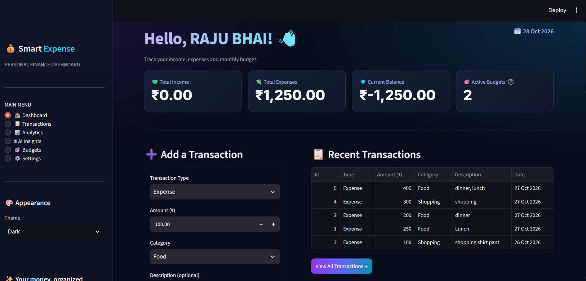
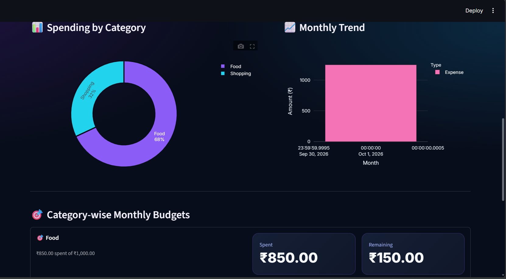
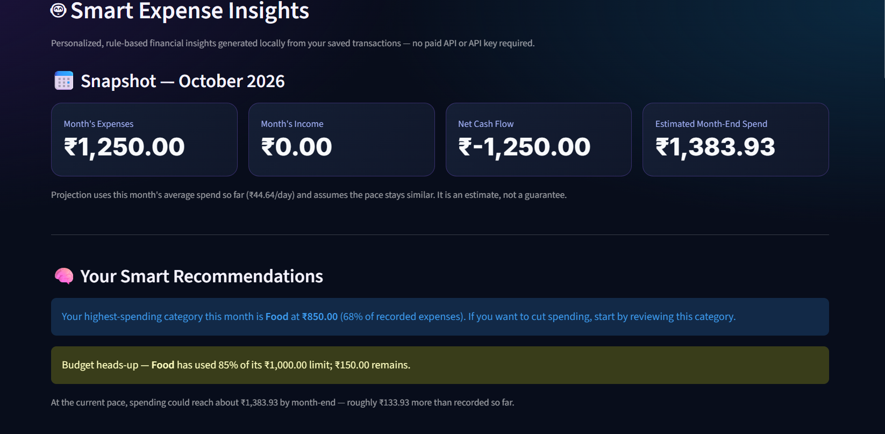
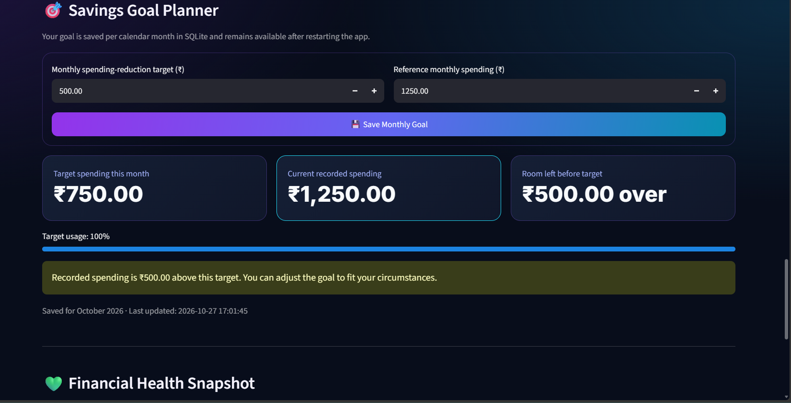
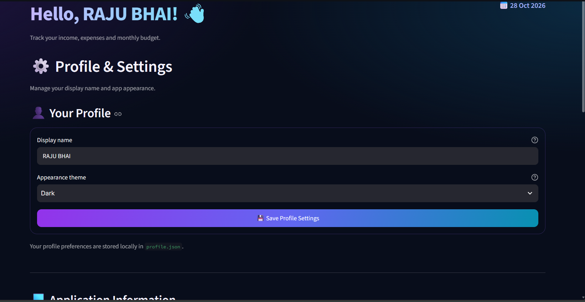

# 💰 Smart Expense Tracker


A Python-based personal finance application built with **Streamlit, Pandas, and SQLite** to help users track expenses, monitor spending habits, manage budgets, and plan savings.

## ✨ Features

- 📊 **Expense Tracking** — Record and manage personal expenses.
- 📈 **Spending Analytics** — Visualize spending patterns and expense summaries.
- 🤖 **AI Insights** — Explore financial insights provided by the application.
- 🎯 **Savings Goal Planner** — Set monthly savings goals and track progress.
- 💡 **Budget Monitoring** — Review spending and stay aware of your budget.
- 🎨 **Theme Settings** — Customize the application theme.
- 💾 **Local Data Storage** — Store expense data using SQLite.
- 🧪 **Database Tests** — Test core database functionality.

## 📸 Screenshots

### 🏠 Dashboard
Track income, expenses, current balance, and recent transactions.



### 📊 Spending Analytics
Visualize category-wise expenses and monthly spending trends.



### 🤖 Smart Expense Insights
View spending summaries, estimated month-end expenses, and rule-based recommendations.



### 🎯 Savings Goal Planner
Set monthly spending-reduction targets and monitor progress.



### ⚙️ Profile & Settings
Customize your display name and application theme.



## 🛠️ Tech Stack

| Technology | Purpose |
|---|---|
| Python | Core application logic |
| Streamlit | Interactive web interface |
| Pandas | Data processing and analysis |
| SQLite | Local database storage |
| Plotly | Interactive data visualizations |

## 🏗️ Project Architecture

The application follows a simple modular structure that separates the user interface, database operations, and automated tests.

```text
smart-expense-tracker/
├── app.py              # Streamlit user interface and application logic
├── database.py         # SQLite database operations
├── requirements.txt    # Python dependencies
├── test_database.py    # Database tests
├── screenshots/        # Application screenshots for documentation
├── .gitignore          # Excludes local and sensitive files
└── README.md           # Project documentation
```

### 🔄 How It Works

1. **User Interface (`app.py`)** — Provides the Streamlit interface for interacting with the expense tracker.
2. **Database Layer (`database.py`)** — Handles database-related operations using SQLite.
3. **Data Storage** — Expense records and related data are stored locally in the SQLite database.
4. **Testing (`test_database.py`)** — Contains tests for checking core database functionality.
5. **Dependencies (`requirements.txt`)** — Lists the Python packages required to run the application.

### 🧪 Quality & Maintainability

Separating database operations from the interface makes the project easier to test, maintain, and extend with future features.

## 🚀 Getting Started

### Prerequisites

- Python 3.10 or a compatible version
- Git
- pip

### 1. Clone the repository

```bash
git clone https://github.com/Rajukumar1202/smart-expense-tracker.git
cd smart-expense-tracker
```

### 2. Create a virtual environment

**Windows:**

```powershell
python -m venv .venv
.venv\Scripts\Activate.ps1
```

### 3. Install dependencies

```bash
python -m pip install -r requirements.txt
```

### 4. Run the application

```bash
python -m streamlit run app.py
```

The application will open in your browser. If it does not open automatically, follow the local URL displayed in the terminal.

## 🧪 Run Tests

Run the database tests with:

```bash
python -m pytest test_database.py -v
```

If pytest is not installed, install it first:

```bash
python -m pip install pytest
```

## 📁 Project Structure

```text
smart-expense-tracker/
├── app.py
├── database.py
├── requirements.txt
├── test_database.py
├── .gitignore
└── README.md
```

## 🔐 Data & Privacy

- The current application uses a local SQLite database.
- Local database files and personal profile settings should not be committed to GitHub.
- Never commit passwords, API keys, or other secrets.
- Cloud storage and deployment are not yet documented as available features.

## 🗺️ Roadmap

- [ ] Cloud database integration
- [ ] Secure user authentication
- [ ] Online deployment
- [ ] Additional financial reports and analytics
- [ ] Expanded automated test coverage

## 👨‍💻 Author

**Raju Kumar**

GitHub: [@Rajukumar1202](https://github.com/Rajukumar1202)

## 📄 License

No license has been specified yet. All rights are reserved by the copyright holder unless a license is added to this repository.

---

⭐ If you find this project useful, consider starring the repository!


## 🚀 Installation & Usage

### Prerequisites
- Python 3.10 or later
- Git

### 1. Clone the repository

```bash
git clone https://github.com/Rajukumar1202/smart-expense-tracker.git
cd smart-expense-tracker
```

### 2. Create a virtual environment

**Windows (PowerShell):**
```powershell
python -m venv .venv
.venv\Scripts\Activate.ps1
```

**macOS / Linux:**
```bash
python3 -m venv .venv
source .venv/bin/activate
```

### 3. Install dependencies

```bash
python -m pip install -r requirements.txt
```

### 4. Run the application

```bash
python -m streamlit run app.py
```

The application will open in your browser, usually at `http://localhost:8501`.

### 5. Run database tests

```bash
python -m unittest test_database -v
```

## 🗄️ Data Storage

The application uses SQLite for local data storage. Transaction data is stored locally when the application runs on your computer.

**Note:** The repository does not include personal transaction records or local database files.

